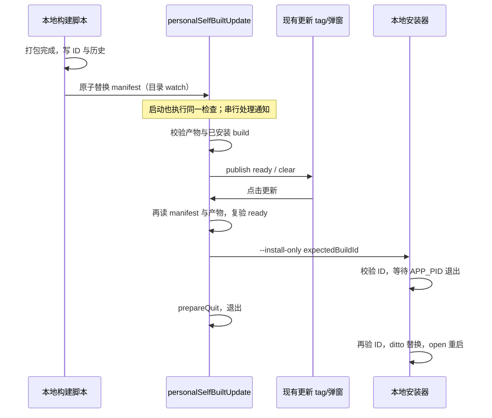

# personal-mods 本地构建更新

## 产品规则与边界

personal-mods 的 macOS Preview 应用只消费本机已完成打包的产物。启动检查一次，之后监听 `~/.zcode/v2/personal-mods-update.json` 所在目录的构建完成通知；不轮询、不下载、不读取 CI Release 清单。CI 继续发布 zip/dmg/Windows 安装包和发布清单，供别人手动下载。

本地 manifest、产物 `.personal-build-id` 必须一致；安装脚本必须存在，产物路径必须是该脚本所在仓库的 `packages/desktop/dist/mac-arm64/ZCode Preview.app`，且包含 Info.plist、可执行文件及 app.asar。缺失、半成品、同 build 不显示已有更新 tag。双方都有可解析 UTC 构建时间时，仅本地时间严格更新才可安装；p<N> 只是展示序号，不能用本地离线计数与 CI tag 计数决定新旧。已装包无 ID（旧 dmg）允许升级到有效本地 build；已有但不可解析 ID 时保守不提示，避免无法判断新旧时回退。

## 所有者与接口

- `sync-personal-mods.sh` 是本机构建元数据的唯一写入者：完成打包后写 ID 和历史，最后原子替换 manifest，作为完成通知。复用产物必须验证源码 HEAD 和构建 ID，不依赖目录 mtime。
- `personalSelfBuiltUpdate.ts` 是本地候选状态唯一所有者；启动、watch 和点击共用 ready 判断。检查串行执行，检查中收到通知继续检查，旧异步结果不发布。
- 检查管线每个相位（ready 读取、更新说明组装）必须有界：任一相位超过 8 秒即写 warn 并按兜底文案继续发布，不允许无界 await 让发布静默消失（2026-11-16 实测四个新实例全部无发布且无日志，唯一无界点是更新说明组装内的设置读取）。每次检查写相位日志（ready 结果、发布结果），应用不点亮时以此为第一诊断入口。
- `autoUpdater.ts` 现有 publish/clear 接口拥有更新 UI 投影。官方 production updater 启用时不启用个人更新源。手机及远端会话协议不涉及此功能。
- 点击先复验本地 ready，再将明确的 buildId 交给 `--install-only <buildId>`；安装器在等待退出前后验证同一产物 ID，拒绝构建期间替换候选。重复点击只启动一个安装器。安装器仅复制本地已打包文件，不 fetch、不构建、不下载。



## 可重复验收

不新增 App 业务单测。运行时验收可在隔离 HOME、假 app 路径与 Electron/更新状态/进程适配器中加载当前模块，记录 publish/clear/spawn/exit：

1. 启动存在新有效本地 build，发布现有更新 tag；同 build、较旧 build、缺失或不匹配 ID、缺少包文件均不发布。
2. 本地 p 序号更低但时间较新仍可更新；序号更高但时间较旧不提示；无已装 ID 可升级。
3. 启动清单缺失后完成构建，原子 rename 通知能发布；检查中连续通知最终只发布最新有效状态。
4. 点击前删除或替换产物，复验失败不 spawn、不退出并清理状态；有效点击只调用本地安装器并传 buildId，重复点击不重复安装。
5. 无远程 fetch、远程 timer 或远程安装分支；CI 发包脚本和 workflow 的执行步骤保留。
6. 把说明组装适配器换成永不 resolve 的 get：相位超时后仍发布兜底文案并写 warn 相位日志；正常路径每次检查留下 ready 与发布两条相位日志。
7. 工程脚本回归使用临时仓库与假命令：未知选项立即失败；安装前后 ID 变化拒绝替换；只在有效本地产物上复制和重启；测试不得操作真实 /Applications 或退出真实应用。

## 本次隔离验收入口

本次会话的探针保存在 `/tmp`，不纳入 App 单测，也不操作真实应用。仓库根目录执行：

```bash
node /tmp/personal-install-regression.mjs
node /tmp/personal-local-runtime.mjs
bash -n scripts/sync-personal-mods.sh
pnpm typecheck
pnpm lint
pnpm architecture:check --changed
```

安装脚本探针复制当前脚本到临时目录，将 APP/DIST/PATH 改为夹具路径，使用假的 ditto/open/pgrep；覆盖未知选项、缺失 ID、ID 不符、等待期间 ID 变化和有效复制。运行时探针用 TypeScript 转译当前模块，在隔离 HOME 和 Electron/进程适配器下加载，使用真实目录 watch；覆盖启动候选比较、完整性、原子发布、点击复验和重复点击。探针会在临时目录留下夹具供检查，重跑会创建新的隔离目录；系统清理 `/tmp` 后需按上述场景重建探针。

真实安装与重启必须在允许退出应用的独立验收中执行；静态检查与隔离场景不等同于该验收。
