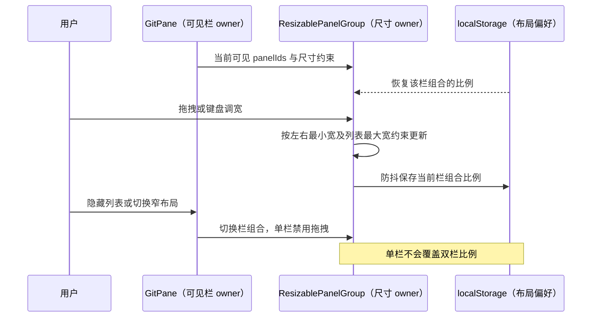
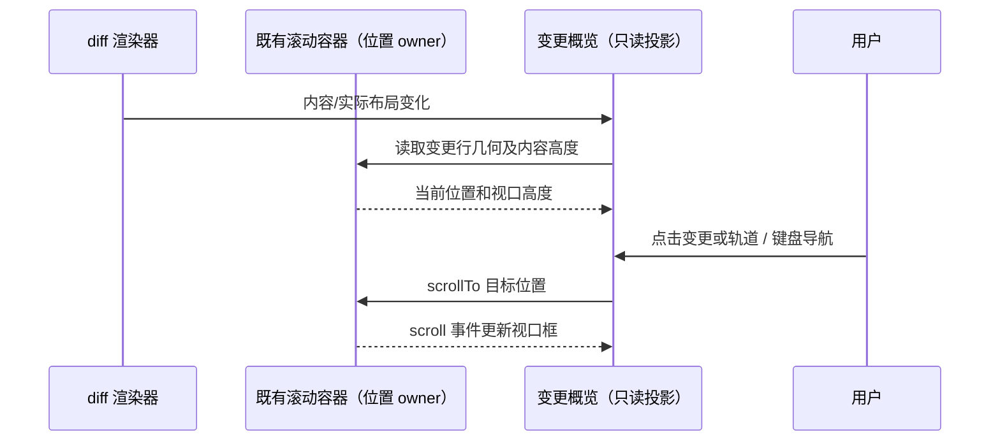
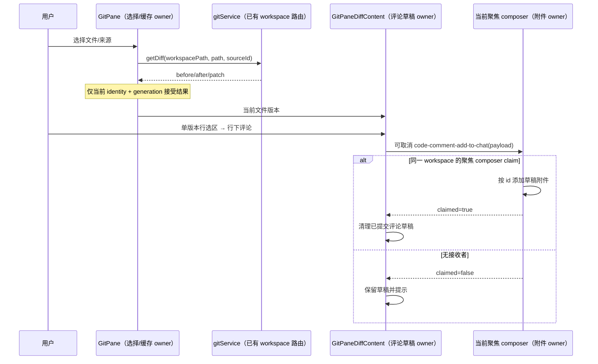
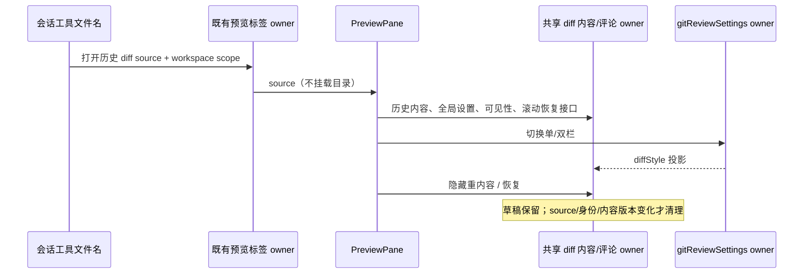

# Git Review Split Layout Spec

## 产品规则

- Review 使用文件预览的紧凑视觉：左侧平铺变更文件列表（文件图标、文件名、增删统计和路径过滤），右侧展示选中文件的 diff；列表可隐藏。列表不展示灰色路径文字，完整相对路径仅在悬停提示中显示，右侧内容头仍保留路径。Git 状态使用文件名颜色表达，复用文件树的 `text-git-*` 状态色，不再在行首显示 M/U/A/D/R 字母；图标保留文件类型原色。手动回归检查 modified 与 untracked 的文件名颜色和取消状态列后的对齐。
- 文件行的增删统计独立占据右侧宽度，文件名只能在剩余空间内显示，超长时省略，不能覆盖计数；悬停仍展示完整相对路径。手动回归使用长文件名和三位以上计数，检查窄列表中两者仍有间隔。
- 宽布局的文件列表与 diff 之间可拖拽调宽，复用文件预览的全高分隔线及键盘交互。列表初始宽度 240px、最小 180px、最大为可分配宽度的 60%，diff 最小 280px；不允许拖拽折叠，列表显隐仍由工具栏按钮控制。单栏布局占满宽度并禁用拖拽。
- 默认 split 双栏，**新版 after/additions 在左，旧版 before/deletions 在右**，不额外显示“新版 / 旧版”标签行，文件头下直接展示 diff。可切 unified；两种模式均遵循全局“代码设置 → 长行自动换行”：开启时折行，关闭时保留长行并允许横向滚动。
- 有完整 before/after 且未超过 rich 阈值时，未修改上下文默认全部展开。超大文件保留 patch/plain-text 降级及截断提示，不承诺补全 patch 未携带的上下文；降级同样遵循全局换行设置。
- diff 内容右侧提供窄幅变更概览条：绿色表示新增、红色表示删除，并用半透明框显示当前视口。两类标记分列，新增在左、删除在右，避免同一位置相互覆盖；不增加“新版 / 旧版”标题。点击色块跳到对应变更并尽量置于视口中部，点击空白轨道按比例跳转；支持键盘滚动导航。
- 概览比例以当前实际渲染内容高度为准，包含折行、split 对齐空位和行内评论高度。完整 rich 展示映射全文；patch 和轻量降级只映射当前可见预览，不补造省略内容位置，原有截断提示保留。不可用、二进制及没有可渲染变更时不显示概览条。
- 在单一版本的行号区域拖选，或点击/拖动行号旁的 +，在选区末行下显示共享 CommentDraft；可填评论或留空，快捷键与文件预览一致，Esc 取消。正文原生文本选择仍可复制，引用按完整行确定。
- 提交将 Code comment 附件添加到当前聚焦会话的输入草稿，**不自动发送会话消息**。只有 composer claim 事件后才关闭评论草稿；没有接收者时保留草稿并提示。
- 单/双栏与列表显隐为 Zustand 持有的本地展示偏好，localStorage key 为 `zcode-git-review-settings`；不广播到其他窗口。过滤条件在列表隐藏或窄屏切换期间保留。
- 窄面板（实际宽度 <560px）使用列表/内容二选一，列表占满宽度，内容头有返回列表按钮。

## 状态所有者与接口

- `GitPane` 唯一持有选择、路径过滤、diff 懒加载缓存和请求 generation。文件列表仅展示和发送选择/过滤 intent，`GitPaneDiffContent` 持有当前文件版本的未提交评论。
- 换行偏好唯一来源为现有 Zustand `codePreviewSettings.wrapLongLines`，通过 GitPane props 传入内容区，不新增审查专用开关或持久化字段。设置变化立即更新 rich/patch 的 `overflow` 与轻量预览的 `wrapLongLines`；布局重排由现有渲染通知及尺寸观察触发概览重新测量。纵向滚动由审查内容容器管理；关闭换行时，富 diff 复用库的横向滚动和 split 同步，轻量预览使用内容容器横向滚动。
- 分栏尺寸由共享 `ResizablePanelGroup` 内的布局库唯一持有，使用 `layoutId="git-review-layout"`，不在 Zustand 再保存宽度。按当前可见的 `file-list` / `diff` panel ID 组合恢复、记忆比例；隐藏列表和窄布局的单栏组合不覆盖双栏记录。拖拽只改变布局，保留当前选择、过滤和仍可见的评论草稿。

- 概览条只投影现有 diff 滚动容器的 `scrollTop`、视口高度与实际变更行位置；该 DOM 容器仍是滚动位置唯一所有者。概览组件不保存 Git 数据、不建立第二个滚动面、不把布局状态持久化。内容渲染、宽度/字号变化、模式切换和评论高度变化时重新测量；普通滚动只更新视口投影，测量按动画帧合并，卸载时清理监听。

- `DiffViewer` 透传 diffStyle、expandUnchanged、overflow、选行和 lineAnnotations；不持有业务状态。通过库 unsafeCSS 改变 split 列的视觉位置，不交换 before/after 输入、颜色或行号语义。既有调用方默认行为保持不变。
- `CommentDraft` 由文件预览和审查共用。注解挂在所选版本末行下，不放在整个文件末尾。
- 附件唯一写入路径为 `dispatchCodeCommentAddToChat` → 聚焦 composer 的 `useCodeCommentContexts`；预览派生状态不能成为第二份会话附件事实。
- 切换文件、来源、workspace 身份或内容版本时取消对应旧草稿，避免把旧选区发送到新文件。缓存失效递增 generation；过期请求不得写回，也不得删除新 generation 的 pending 标记。

## 行号与文件版本

- `side` 为文件版本语义：R 对应 after/additions，L 对应 before/deletions，与视觉左右无关；普通文件预览未带 side 时保持 R 兼容。
- `SelectedLineRange` 的起止 side 相同时，从该版本全文按一基闭区间精确截取。未显式带 side 时使用库 additions 坐标。越界、缺失内容、跨版本端点不得近似转换或夹到最后一行；跨版本选择提示用户在一个版本内重新选择，保留已有评论草稿。
- 接收校验和历史解析只接受 L/R 或兼容缺省，未知 side 拒绝；markdown 序列化、草稿附件和历史恢复保留 side。审查附件显示新版/旧版，旧版附件不得在当前文件的新版行号下伪装成同一段代码。
- rich 全文和已验证单文件 patch 均可按实际存在的同版本行创建评论；patch 必须逐行验证选区覆盖，跨省略区间拒绝。正常新增/删除文件的不存在一侧由 Repo 表示为空串；null 表示内容未知，不能假定为空文件。删除文件可选旧版内容。

## 路径、平台与边界

- `sourcePath` 使用实际文件路径：绝对路径直接使用，否则相对 `workspacePath` 拼接；展示使用 `workspaceRelativePath`。
- 身份 key 为 `workspaceIdentity?.trim() || workspacePath`，缓存失效及附件接收均遵守该边界。远程预览携带 workspaceIdentity 和 workspaceRemoteSessionId，复用已有 Host attachment/服务路由。
- 打开预览通过已有 onOpenCodeViewer 回调；文件动作通过 UI hook 和 IPlatformService。此改动不新增 Host、Agent、队列、snapshot 或连接，也不改变 desktop-continuous / web-remote-replayable 的同步语义。
- 本地/远程右键动作能力位遵守 `git-review-file-context-menu.md`。二进制、不可用、截断数据使用明确降级提示，不开启不准确的评论功能。

## 会话 diff 复用

- 会话编辑文件名、变更摘要 Review 打开的 patch / multi-file-diff source 直接挂载预览，不显示文件目录及其开关；不修改原文件管理器目录偏好。
- `PreviewPane` 头部复用 `gitReviewSettings.diffStyle` 的唯一 store setter，默认 split，新版左；内容经 `GitPane/contract.ts` 的 `DiffPreviewContent` 使用同一渲染、全局字体/换行与概览。普通文件预览不变。
- source 保留历史定位，通过现有 conversation/fileChanges 按需取对应工具/回合的完整版本；完整内容对默认全文展开，不因旧 rich 阈值退回局部 patch。历史缺失明确提示并保留可用片段。patch 仅能引用真实存在且连续的同版本行，不补全缺失行。查询、状态与回归合同见 [历史全文规格](ui/historical-diff-full-content.md)。禁止把当前工作区文件当作工具执行时全文。
- PreviewPane 保留 source 和滚动恢复记录；DiffPreviewContent 保留当前版本的评论草稿，inactive/resize 时只暂停重渲染，不卸载该 owner。真实滚动容器向 PreviewPane 上报位置并接受恢复 ref；恢复展示时重新测量概览。workspaceIdentity 与实际 sourcePath 沿原预览 scope 传递。

## 验收

- 真实 Desktop E2E 检查 split 的 additions 几何位置在 deletions 左侧、远离 hunk 的首尾上下文可见；折行验收显式开启全局设置后检查长行宽度不溢出。本轮手测开关该设置，确认 split/unified、patch/plain-text 都在折行与横向滚动之间即时切换，概览位置同步，评论草稿不丢失；文件头与 diff 之间不再出现“新版 / 旧版”标签行。
- 点击/拖动新版行号 → 末行下注解 → 可空评论提交 → 当前会话出现新版附件；旧版附件保留旧版文本与行号。没有接收者时草稿保留；跨版本选区不产生近似引用。
- 切 unified/split、列表显隐和本地偏好恢复；路径过滤、选择、窄布局返回；普通文件预览共享评论组件不回归。
- 本轮由用户手测：左右拖拽列表/diff 分隔线，检查最小宽度、长文件名省略、计数间距和列表不显示灰色路径；Tab 聚焦后方向键调整。调宽后隐藏/显示列表、拖窄再恢复、重开审查，检查双栏比例恢复及选择/过滤保留；保持 diff 可见时，显隐列表不丢失未提交评论。按用户要求不运行本轮 E2E 或业务单测。
- 概览手测：全文顶部、中部、底部的增删均有对应色块；点击色块定位正确，滚动时视口框同步；split/unified、拖拽调宽导致折行、改变字号及展开/取消评论后重新对齐。切文件、加载态及 binary/unavailable 不显示旧文件色块。patch/plain-text 降级只展示当前预览范围，截断提示仍可见。维护既有 E2E 的概览几何、点击与键盘场景，本轮不执行。
- 检查来源切换与 stale response、deleted/新增、last-turn、超大文件降级；远程身份与手机 Web 运行时若未执行，交付时明确说明，不用静态检查替代。
- 测试入口：`packages/desktop/test/e2e/conversation-session/projects/conversation-session-git-review-entry.test.ts`，由 Desktop `test:e2e:serial` 执行。
- 必须执行根 `pnpm typecheck`、`pnpm lint`（复核 Hooks 诊断）、`pnpm architecture:check --changed`，以及本次改动文件格式检查；报告真实结果。
