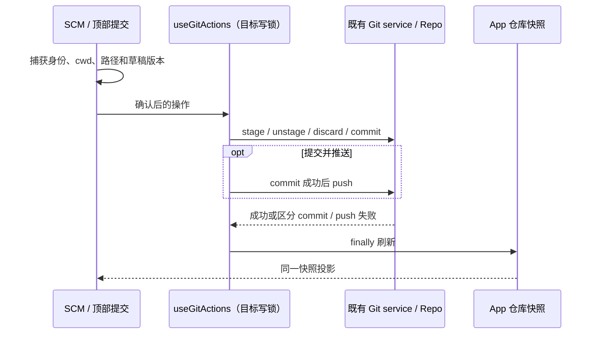
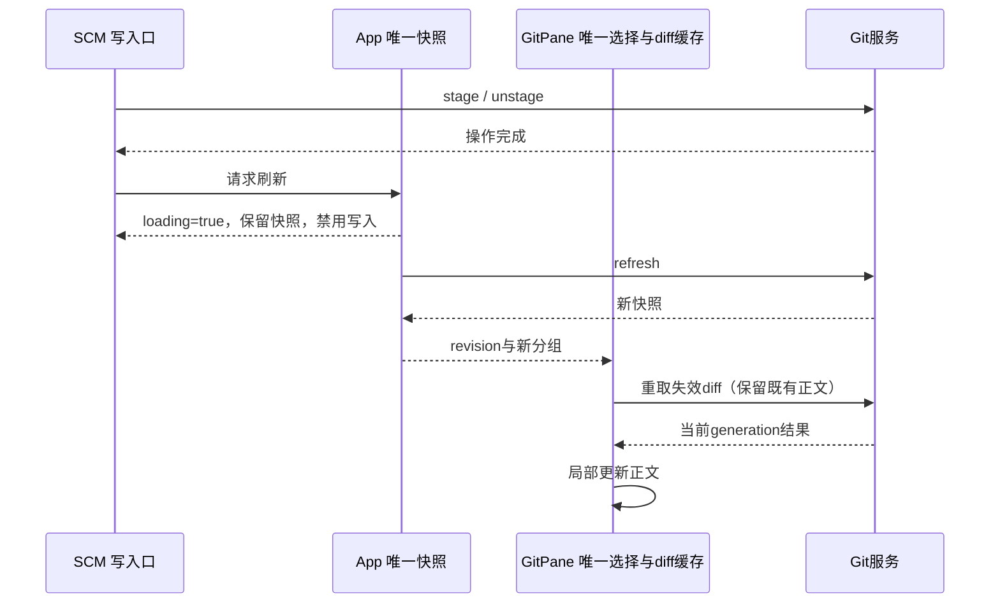
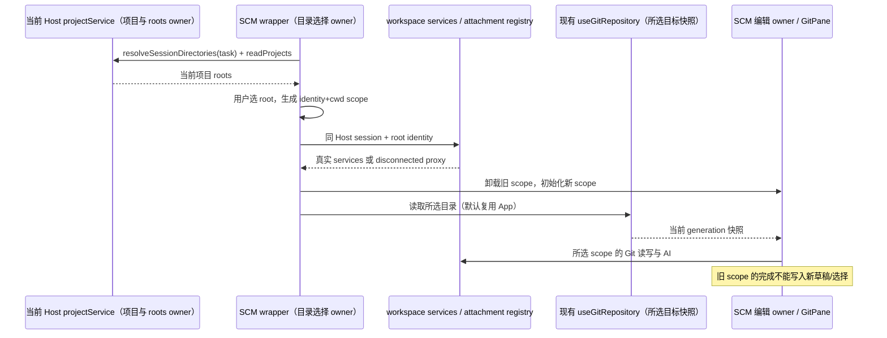

# 源代码管理标签页

## 范围与产品规则

右侧 SidePane 的“新标签页”launcher 提供“源代码管理”入口，与文件、浏览器、终端、部署及辅助对话同级，打开独立 `source-control` 标签。每个 workspace 仅一个 SCM 标签，重复打开激活已有标签；沿现有 tab 的关闭、最近关闭恢复、排序及 workspace 内存恢复。不存在左侧项目/会话导航入口。SCM 作用域为活动任务 cwd，否则当前 workspace；身份使用 `workspaceIdentity?.trim() || workspacePath` 加 cwd。手机使用相同标签内容。SCM 内嵌同一 GitPane：选择文件在当前 SCM 标签内查看 diff，不打开另一 review 标签，提交草稿保留；切换 cwd 重建草稿作用域，不串用旧目标草稿。

SCM 使用 VSCode SCM 的两栏结构：左侧默认 320px、可拖宽的列表栏（展开全屏或容器变宽时保留像素宽度，由 diff 吸收剩余空间），从顶部依次排列紧凑标题工具栏、仓库名/分支、短提交输入（随内容扩高，上限 160px）、AI 生成入口、满栏提交 split button（主操作提交，下拉提交并推送）；push/重试 push 位于菜单。右侧 diff 从分栏顶部占满剩余宽高，不被提交区下压。空仓库仍保留左栏提交区；窄屏列表→diff→返回，提交区仅在列表侧。已暂存、更改、冲突分组支持折叠，标题显示箭头与计数徽章，批量动作始终可见（不依赖 hover/focus）。

提交 split button 两半共用背景与整组禁用淡化：仓库不可用、写入/刷新忙碌或提交与推送均不可用时，两半同时禁用；仅推送可用时下拉仍可打开，两半背景一致，仅提交文字和图标弱化。整组与子按钮不得重复叠加 opacity。没有暂存但存在更改时，填写信息后仍可确认暂存再提交。

仓库信息行的仓库名、分支图标和分支名统一 flex 垂直居中；仓库名和分支名分别允许截断，图标不收缩，长名称不得挤出列表栏。

SCM 文件行为文件图标、普通前景文件名、灰色父目录描述、最右 Git 色状态字母（M/U/A/D/R 等；暂存按 x，未暂存按 y，AM 同文件分别为 A/M），不展示逐行 +/- 统计。hover/focus 显示打开文件、丢弃（仅未暂存）、暂存 plus 或取消暂存 minus 的直接图标，无逐行三点菜单；触屏常显。保留右键菜单，图标点击不触发行选择。文件和分组支持暂存/取消暂存；已暂存组只提供取消暂存，不提供丢弃。丢弃必须先展示确切路径并确认，未跟踪删除只允许明确单文件路径，禁止全仓库 clean。跨 workspace 边界的 rename 可显示，但拒绝写操作并呈现服务错误。

SCM 在仓库名/分支行右缘提供“隐藏测试文件”图标开关（默认显示测试文件，状态持久化在现有 `gitReviewSettings` 展示偏好）。开启后，测试目录或测试命名规则匹配的变更从已暂存/更改列表隐藏，当前选择回退到首个可见文件；分组计数、批量暂存/丢弃以及无暂存时的“暂存并提交”范围都只包含可见文件，隐藏项不会在用户看不到的情况下进入提交。冲突条目不受隐藏影响，避免阻塞原因不可见。隐藏只影响 SCM 列表投影，不改变 Git 快照、index 或普通 Git 审查面板。测试文件判定收敛在单一纯函数 `isTestFilePath`：路径段命中 `test`/`tests`/`__tests__`/`__test__`/`spec`/`e2e`/`testdata`/`__snapshots__`/`__mocks__`/`__fixtures__`/`cypress`，或文件名命中 `*.test.*`/`*.spec.*`/`*.test-d.*`/`*_test.go|py|rb`/`test_*.py`/`*Test(s).java|cs`/`*_spec.rb`/`*.snap`/`conftest.py`。判定按路径段与文件名，不能用子串匹配（`latest.ts`、`contest.ts`、`tests.ts` 不能误判）；`specs` 等产品目录名不参与目录判定，避免把规格源码当成测试。隐藏后列表为空时显示专用空状态并提供恢复入口，不能显示“当前来源下没有可展示的改动”。

默认仅提交当前 cwd 范围的 index，保留同文件未暂存内容及范围外暂存。没有暂存文件时，先确认将当前范围更改暂存再提交。冲突阻止提交。Cmd/Ctrl+Enter 提交。失败保留草稿；提交成功但推送失败显示独立状态并允许只重试 push。首版不新增 pull/fetch/amend/stash/提交图。

## 所有者与接口

- App 的 `useGitRepository` 是默认任务 cwd 的唯一 Git 快照 owner；SCM 默认复用该快照。选定其他项目 root 时，SCM scoped child 使用同一 `useGitRepository` / `useGitAutoRefresh` 管理所选目标唯一快照，卸载即释放；不复制 App 快照、不创建全局 Git cache，header/review 继续绑定任务 cwd。
- `useAppPanels` 与 workspaceSidePane 持有标签生命周期，SCM 属 workspace 级单例。SCM 组合 GitPane 的提交区、分组与操作插槽。GitPane 持有唯一 source/path 选择，保持既有 split/unified/editor、diff generation 和缓存。标签序列化形状与既有 workspace 内存恢复一致，不新增持久化 store。
- `useGitActions` 是写操作入口，复用 GitActionMenu 的 stage → commit → push 服务顺序；同身份/cwd 的写操作互斥，finally 刷新。远端服务沿既有连接路由，不回落本地。
- 草稿按身份+cwd 隔离。AI 使用现有 `generateCommitMessage`、已解析 locale 与 Host preferred model；请求开始捕获草稿版本，编辑、切目标、卸载后旧响应不得覆盖。SCM 不用会话文件摘要缩窄 workspace 范围。
- Repo 验证路径在 workspace 内，rename 同时涵盖原路径；unborn unstage 只移除 index，不删工作树。零行、二进制、大文件 untracked 仍是可操作的状态条目。

Desktop continuous 和手机 replayable 的任务连接沿用现有 Host attachment/lease；Git 不新增会话或交付协议。

## 验收

- Launcher 打开 SCM 标签，重复打开不重复创建；关闭后可从最近关闭恢复。选择 staged/unstaged 文件在当前 SCM 标签打开正确 source/path diff，保留草稿。折叠/展开、窄面板与手机布局正常；identity 与 worktree cwd 切换不串数据。
- 同文件同时 staged/unstaged 时默认提交 index，工作树剩余改动保留；cwd 外的暂存保持原样。
- 无暂存时取消确认不写 index；确认后只 stage 当前范围；冲突可见且阻止提交。
- AI 生成中编辑草稿、切 workspace/任务 cwd，旧响应不覆盖；失败保留草稿。
- 提交成功 push 失败后只重试 push，不重复提交；同目标重复点击和两个入口互斥。
- 空/二进制/大 untracked 可见；逐文件丢弃确认列出路径，范围外文件保留；unborn unstage 保留文件；rename 不遗留原路径暂存。
- 隐藏测试文件开关：默认显示；开启后测试路径消失、分组计数与批量动作只覆盖可见文件；提交只包含可见路径；关闭后恢复全部条目且选择仍有效；开关状态跨重载保持。
- 验证 Desktop E2E Git commit / conversation git review entry、真实隔离临时仓库、typecheck/lint/architecture changed。不新增 App 业务单测。

## 刷新连续性

同身份、同 cwd 的后台刷新保留现有快照与布局，只更新文件分组和 diff；不重挂 GitPane、不以整块 loading 替换已展示正文。初次读取或切换目标仍显示加载态，不展示旧目标缓存。GitPane 的唯一 diff cache 按 revision 失效重取，刷新期间保留同 source/path 的旧正文，generation 拒绝旧响应；新 diff 成功后局部替换，失败显示明确错误。选择优先保留 source/path；该条目因暂存移动时跟随同 path 的另一分组，只有路径消失才选择剩余条目。提交草稿、列表/diff 滚动容器与分栏保留；内容缩短时仅允许浏览器自然夹紧滚动位置。写操作直到共享快照刷新结束仍禁用，不能用 timeout 解锁。

验收通过真实 Git E2E 连续 stage/unstage，观察提交输入、GitPane、列表和 diff DOM 在刷新期间不移除；断言草稿、选择、滚动和分栏稳定，刷新期间写入口禁用，最终 index 与分组/diff 一致。初始加载及切 workspace 不沿用旧目标正文。

## 当前项目目录选择与作用域

SCM 头部提供目录选择器，选项仅含当前任务所属项目的 `VirtualProject.roots`，以及默认任务实际 cwd（含 worktree）。通过当前 Host 的 `projectService.resolveSessionDirectories` 解析任务归属，再读取该项目 roots；草稿读取已有 draftProjectId。不查询全局项目作为菜单，不创建或切换会话、workspace tab 或分支。分支仍为只读文本。目录完整路径在选项与 tooltip 可辨认；非 Git 目录保留选择器并显示既有不可用状态。

SCM wrapper 是选定目录的唯一 owner。默认任务 cwd 使用原 workspace identity；其他远端 root 用统一 `buildRemoteHostWorkspaceIdentity` 构造 identity，并沿原同 Host attachment 经 `useWorkspaceServicesResolution` 解析 provider。status/list/diff/stage/unstage/discard/commit/AI/push 及文件操作全部消费同一 scope。远端断连禁止回落本地；Desktop continuous 和手机 replayable 继续使用已有 attachment/lease，不为目录创建 Agent。

选择目录立即重建 identity+cwd 对应的编辑 owner，清空旧提交草稿、确认、错误、文件选择和 diff；切回来也重新初始化。仅同目标后台刷新保留草稿、选择、滚动与正文。旧读取按 useGitRepository/GitPane generation 丢弃，旧 AI 按卸载版本失效；已提交的写操作继续只针对其捕获的旧目录，完成不能清除新目录草稿。项目/任务 scope 变化重置为新任务 cwd，项目 roots 更新移除当前选项时回到默认。

文件行背景由整行 owner 绘制，操作 wrapper 透明且以正常 flex 布局预留宽度，无独立 surface、阴影或边框；不能继承半透明行背景而再次叠加，hover/选中背景贯通状态列和操作区域，图标保留 focus 与 tooltip。文件和分组丢弃统一使用 `Undo2`，真正刷新保留 `RefreshCw`。

验收：同一项目 A/B 两个真实仓库切换，列表/status/diff/暂存/提交/AI/push 均只作用于所选目录；A 的慢请求与写操作完成不污染 B。任务 cwd/worktree 为默认，导航和当前会话不变；目录仅当前项目 roots。无 hover 时分组动作可见；丢弃为 Undo2；选中/hover 行的操作背景与整行一致；原 index-only、局部刷新不卸载正文通过。

## 文件列表一致性

复用 GitPaneFileList 的虚拟化平铺列表、FileDisplayInline、workspace 相对路径 tooltip/过滤、选择态与上下文操作；不新增目录树。SCM 仅扩展 staged/changes/conflicts 分组标题和行操作。GitPane 是唯一 selection 与 diff generation/cache owner，key 包含 source 与 path，部分暂存同路径的两行互不混淆。宽屏沿现有可拖动列表/diff 分栏，窄屏沿原返回列表按钮；提交区作为列表上方插槽，diff 模式沿原 split/unified/editor。
