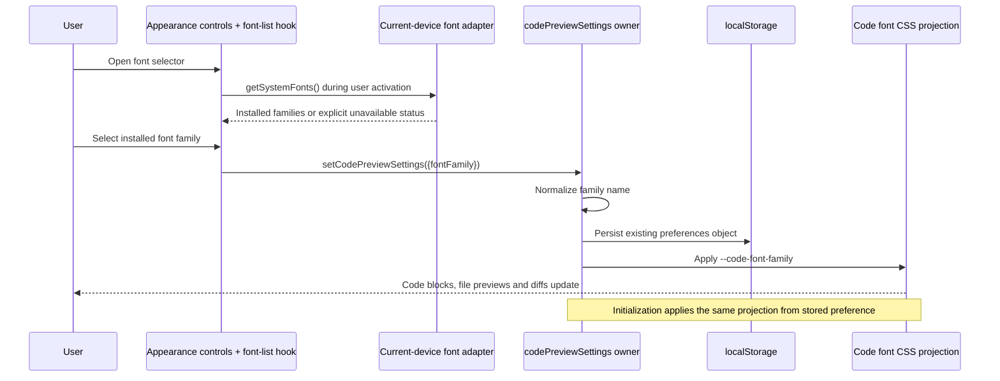

# Appearance Settings

## Goal

Provide one Appearance settings section for application theme, UI font size, and code presentation preferences across desktop, Web, and mobile Web.

## Settings

- App theme: System, Light, or Dark, using the existing theme preference and cross-window synchronization.
- UI font size (Chinese label: `界面字号`): a numeric input from 12px through 20px, default 14px. The preference drives the dedicated `text-ui-*` scale through `--ui-font-size` without changing the root `html` font size.
- Code presentation: light and dark syntax themes, line numbers, long-line wrapping, a code font-family selector, and an independent numeric code font-size input from 12px through 20px.
- Code font (Chinese label: `代码字体`) appears before code font size. The options are Default plus the font families actually installed on the current display device, deduplicated and sorted by family name. Do not offer a hard-coded font catalog, download fonts, or read fonts from a remote workspace host. Default preserves the existing language-aware monospace stack.
- Load the font list when the user opens the selector. Web must use supported browser font-access permission and show a clear unavailable/denied message when access is not possible; it must not fabricate an installed-font list. Preserve the saved choice if enumeration fails or that font is no longer installed, label it unavailable after successful enumeration, and render with the existing monospace fallback. The preview cards update immediately on selection.
- The code-font popup includes a fixed search field that filters installed family names by case-insensitive substring without changing alphabetical order. Keep Default and the saved-but-unavailable choice reachable. Show a no-match message for an unmatched query. Opening focuses search and clears the previous query; selecting closes the popup. Keyboard arrows / Enter select a result and Escape dismisses it.
- Limit the complete popup to 360px and to the available viewport height, with only the result list scrolling. Match the trigger width within the viewport; the popup must not grow with the installed font count.
- Code settings and code preview are stacked vertically. Inside code preview, the light and dark preview cards use a side-by-side layout on `sm` screens and fall back to one card per row below that breakpoint.

## Boundaries

- UI font size and code font size are persisted independently.
- Code and diff rendering continues to consume `codePreviewSettings.fontSizePx`; it does not inherit the root UI `rem` size.
- `codePreviewSettings.fontFamily` stores the actual family name or `default` in the existing `zcode-code-preview-settings` object. The store remains the only mutable owner and persistence path; non-string, empty, or control-character values normalize to `default`. Migrate previous preset IDs to their family names on load and update. CSS serialization quotes and escapes family names, preserving Unicode and preventing names from becoming CSS declarations.
- Store initialization and its setter project the normalized selection to `--code-font-family`. CodeViewer/DiffViewer pass it into Shadow DOM through `--diffs-font-family`; lightweight diff uses it on code content. The existing `--font-mono` and UI typography remain unchanged, including paths, shortcuts and code block headers. Code fonts follow existing code-preference local-window semantics without adding a broadcast path.
- `IPlatformService.getSystemFonts()` returns `available` with validated family names, or `unsupported` / `denied` / `error`. Desktop and Web adapters call the current renderer's `queryLocalFonts()` through a shared browser adapter; no IPC, remote request, Agent protocol, or dependency is added. UI accesses it through `useSystemFonts` in `hooks/usePlatform.tsx`, which owns loading/result state, clears it when the platform instance changes, ignores stale/unmounted requests, and calls directly from selector-open to preserve user activation. The platform adapter validates the unknown API output, deduplicates and sorts; font binaries are never read.
- Settings search indexes the row, and its existing action trace uses `change_code_font_family` rather than the font-size action.

- The integrated terminal retains its own font configuration and is not controlled by either Appearance font-size setting.
- UI font-size changes are applied through `--ui-font-size`, persisted, and synchronized between application windows without mutating `document.documentElement.style.fontSize`.
- The former Code Preview navigation target is replaced by Appearance. A stored legacy `codePreview` target resolves to Appearance.

## Copy

- The interface subsection title is `界面设置` in Chinese and `Interface Setting` in English.
- Describe visible outcomes instead of implementation details such as `rem`, root font size, or UI scaling.
- Interface font-size copy states that icons and layout dimensions do not change with text size.
- Code preference copy covers code blocks, file previews, and diff views rather than only the preview cards on this settings page.
- The light and dark preview cards are displayed together below the controls; copy must not describe them as a single viewer on the right.

## Verification

- Verify Appearance is listed after General and the separate Code Preview navigation item is removed.
- Verify General retains language and system behavior settings but no longer duplicates app theme.
- Verify theme, UI font size, and code presentation controls render together under Appearance.
- Verify both font sizes use numeric inputs rather than drag sliders, and commit on Enter or blur.
- Verify Code settings stays above Code preview, while the light / dark preview cards sit side by side at `sm` layouts and render one card per row below that breakpoint.
- Verify UI font size persistence, clamping, and cross-window synchronization without root DOM font-size mutation.
- Verify code font search/navigation, immediate preview updates, persistence after reload, legacy preset migration / invalid preference fallback, and matching fonts across Markdown code blocks, file previews, rich/patch and lightweight diffs. UI text, paths, code headers, and terminal fonts stay unchanged. Verify fallback on platforms without the selected font and that diff overview geometry updates after font metrics change.
- On selector open, verify installed families are deduplicated and sorted, without separate entries for bold/italic faces. Verify unsupported browsers, denied font permission, load failure and an empty list produce clear messages while preserving the saved choice. After successful enumeration, a saved but missing family is marked not installed; reopening retries enumeration. A mobile remote-control page enumerates its own device, not the desktop workspace host.
- Verify the font popup stays within 360px / the available viewport, search remains visible while results scroll, case-insensitive filtering finds installed families, no-match feedback appears, and selection closes the popup. Reopening clears the query and restores the full list; Default remains selectable.
- Maintain the existing settings E2E for font selection, search, bounded height and persistence. Per user request, this iteration runs static checks only and leaves desktop interaction acceptance to the user.
- Run `pnpm typecheck`, `pnpm lint`, architecture and formatting checks.
