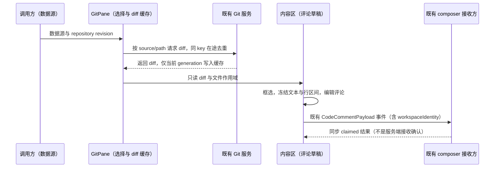

# Git 审查 UI

登记 `GitPane.tsx`、`GitPane/` 和 `lib/gitReviewSettings.ts`，把审查布局的实际 UI owner、子组件和纯偏好定义纳入同一 managed 模块。产品规则与验收场景以 [审查布局 spec](../../../../docs/git-review-split-layout.md) 为准。

- `GitPane` 持有选中文件、路径过滤、窄面板导航与 diff 展示缓存；数据源选择由调用方通过 props 控制。列表只投影过滤条件并管理滚动，内容区只管理当前选区与评论草稿，不建立第二份 Git 数据缓存。
- `gitReviewSettings` 的唯一可变状态与持久化路径仍是 `store/index.ts` 的切片及 `setGitReviewSettings`，只保存 diff 模式和列表显隐。纯偏好定义不读写 localStorage，不新增广播。
- 代码换行读取现有 `codePreviewSettings.wrapLongLines`，rich/patch 映射为 `overflow="wrap" / "scroll"`，轻量预览直接使用原设置。内容区不覆盖全局偏好，设置切换由渲染/尺寸事件更新概览，保留当前评论草稿。
- 内部分栏宽度复用共享 `ResizablePanelGroup` 的布局状态与持久化，`layoutId="git-review-layout"`，按可见 `file-list` / `diff` 组合分别记忆比例；不新增宽度 store 或拖拽 hook。双栏列表默认 240px、最小 180px、最大 60%，diff 最小 280px，单栏禁用拖拽且全宽，拖拽不折叠列表。显隐列表不重挂载仍可见的 diff，保留评论草稿。尺寸事件顺序见 spec。
- `GitPane.tsx` 是审查列表挂载入口；`lib/gitReviewSettings.ts` 是现有 store 的纯偏好入口。其他子组件、overview hook 与 helpers 为内部实现。
- 概览条组件只测量当前渲染的变更行并投影视口，滚动位置唯一所有者仍是 diff 的既有滚动容器。点击/键盘只发出滚动意图；完整渲染映射全文，降级映射可见预览，折行和评论高度参与几何测量，不重新计算 diff 或扩大既有渲染阈值。
- 共享评论 UI 属于 `code-comment`；发送复用 `dispatchCodeCommentAddToChat`，workspace 身份、草稿接收和后续提交沿用既有 composer 链路。本模块不新增 Agent admission、owner/lease 或远程恢复协议。

`ui`、`shared` 仍是 legacy 依赖。此次登记检查本模块的源码规模、依赖声明、公开入口和 UI 实现导入限制；不意味着 store、Git hooks、DiffViewer、composer 或远程交付边界已经整体受管。generation 防陈旧结果、身份隔离、桌面与手机行为仍须按 spec 运行时验收；架构门禁不能证明这些语义。
