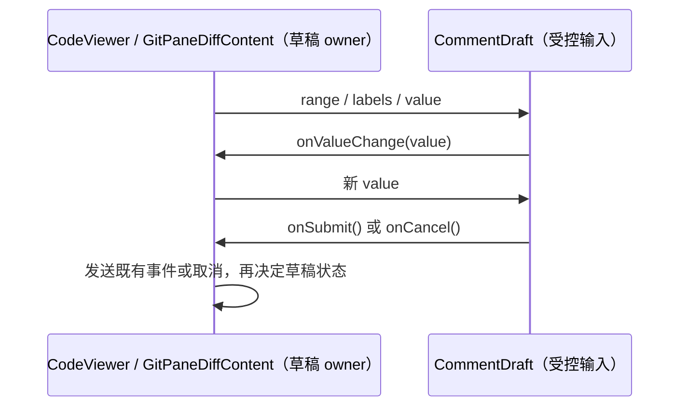

# 代码评论草稿 UI

精确登记 `components/ui/code-comment.tsx`；本目录存放契约四件套，不接管整个通用组件目录。文件预览和 Git 审查共用同一个受控输入组件与快捷键、范围展示函数。

- 调用方持有选区、附言、文件版本和 workspace 作用域；`CommentDraft` 只接收 `range`、`labels`、`value`，通过 `onValueChange`、`onSubmit`、`onCancel` 报告输入意图，不保存第二份草稿或派发会话事件。
- 行区间由调用方提供；归一化函数只排序起止行，不判断 diff 版本，不截取源码。新旧文件与行号映射由审查内容区负责。
- 空附言是否发送、发送是否被接收、何时清空草稿由调用方处理。组件的提交回调返回 `void`，不承诺持久化或 Agent admission 完成。
- `components/ui/code-comment.tsx` 保留为文件预览与审查的公开 UI 入口；`contract.ts` 从实际组件派生 props 并提供同一组标签类型。依赖仅为 legacy `ui` 的基础控件、范围类型与平台快捷键工具。

验收沿用 [审查布局 spec](../../../../docs/git-review-split-layout.md) 与现有文件预览场景，不增加 App 单测。架构门禁覆盖此组件的静态依赖，不验证输入法、快捷键、焦点或评论发送的运行时行为。
